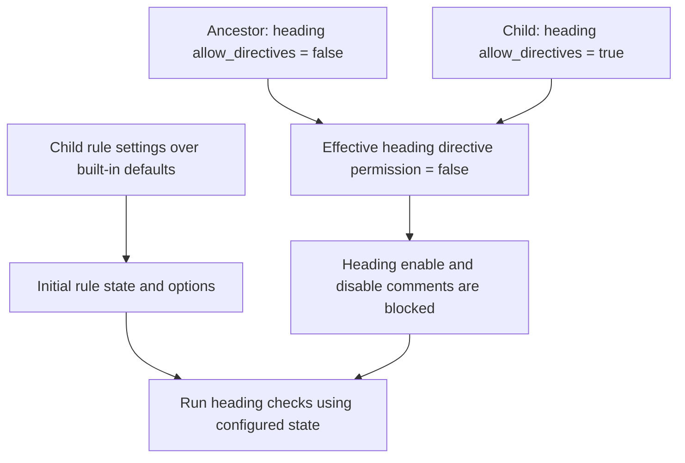
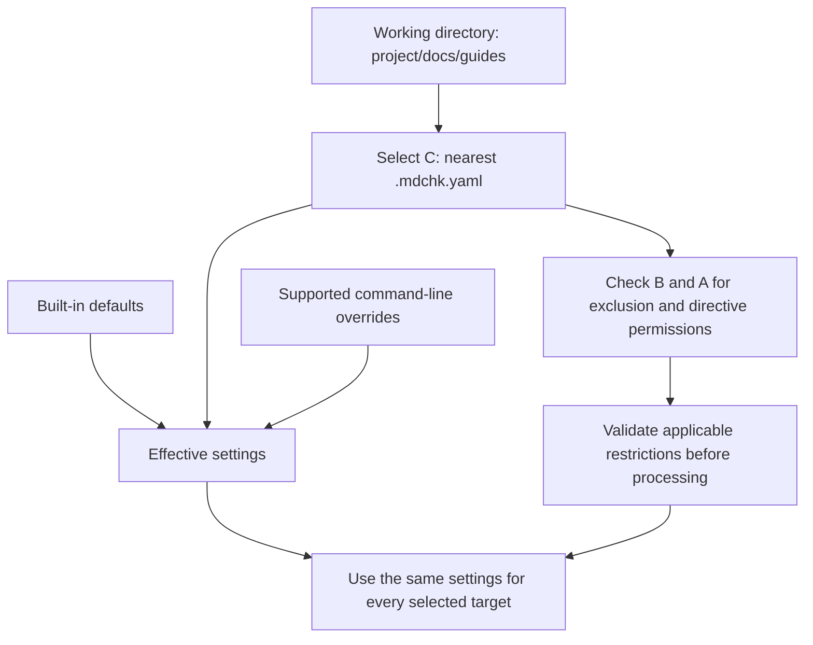
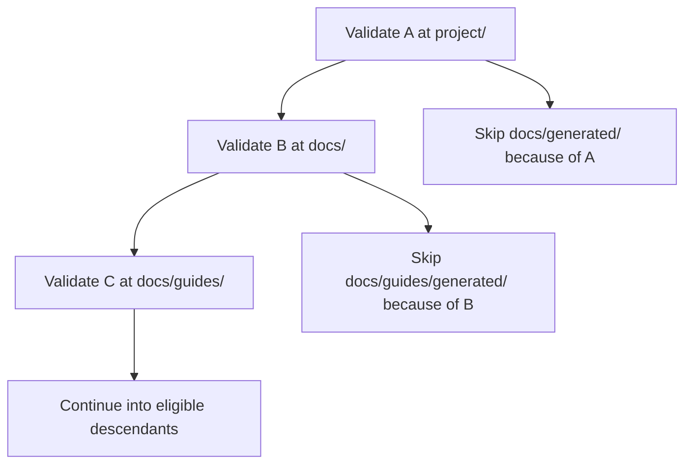

# Configuring mdchk

Use `.mdchk.yaml` to define your project's Markdown expectations. Lint and fix use the same rules and exclusions from the terminal; the planned MCP modes share this contract. Without a configuration file, mdchk uses its defaults, including the supported GFM profile. Missing default rule implementations produce incomplete analysis (`15`).

This is the approved configuration contract. Lint loads and validates configuration before target access, then acquires source snapshots and executes the shared parser and available registered checks. Lint, fix and config validate support text, schema-v1 JSON, VS Code and GitHub reports; inspect supports text/JSON. MD047 terminating-newline analysis, safe previews and apply on the verified Darwin arm64+cgo/local APFS adapter are implemented; MD001 heading-increment analysis and its opt-in `frontmatter_title` setting are also implemented for CommonMark/GFM. MD004 bullet-marker analysis is implemented for both flavors, enabled by default,
with `marker: consistent` or explicit `asterisk`, `plus` and `dash` choices.
MD005 sibling-list alignment analysis is implemented for both flavors, enabled by
default with no rule-specific options. It retains each actual group's first direct
item baseline before directive filtering and emits exact marker-only manual
findings; PlannedFix metadata grants no edits or previews.
MD003 heading-style analysis is also implemented for both flavors, with `style:
consistent` by default and explicit `atx`, `atx_closed` and `setext` choices. MD018
missing opening-hash spacing, MD019 extra opening-hash spacing, MD020 missing
terminal-hash spacing, MD021 closed-heading delimiter spacing, MD022 heading blank-line
analysis, MD023 heading indentation analysis, MD024 repeated heading analysis, MD025
multiple-title analysis, MD026 heading-end punctuation analysis, MD036
emphasis-as-heading analysis, MD041 opening-heading analysis, MD043 required-outline
analysis, MD063 heading-capitalization analysis, MD080 heading-anchor collision
analysis, MD082 empty-section analysis, MD090 thematic-break-before-heading analysis and
MD093 inline-formatting-in-headings analysis and MD081 paragraph-emphasis analysis are implemented. MD093 is available but
disabled by default, with exact `allowed_constructs` choices and nested behavior
documented on its [rule page](rules/headings/md093.md); MD026 is available but disabled
by default and accepts an exact Unicode scalar `punctuation` string (default `.,:;!?`,
empty valid); MD036 is available but disabled by default and has no rule-specific
options; MD043 is available but disabled by default, with an empty `headings` list
performing no check and exact heading descriptors or `*` entries as documented on its
[rule page](rules/headings/md043.md); MD063 is available but disabled by default,
accepts `style: sentence` (default) or `title` and an exact `proper_names` string list
(default empty), as detailed on its [rule page](rules/headings/md063.md); MD082 is
available but disabled by default, with sole boolean `allow_final_section: false` and
the [global-section policy](rules/headings/md082.md); MD080 is available but disabled by
default, compares unsuffixed heading bases through the shared `resources.anchor_style`
policy and has no rule-specific options; MD018 through MD021 and MD023 have no
rule-specific options; MD025 and MD041 accept integer `level` from 1 through 6 (default
1) and boolean `frontmatter_title` (default false); MD024 accepts boolean
`siblings_only`, default false; MD022 accepts nonnegative integer `before` and `after`
minima, each defaulting to 1. MD001, MD003, MD004, MD005, MD007, MD029, MD030, MD032, MD069, MD076, MD077, MD009,
MD018, MD019, MD020, MD021, MD022, MD023, MD024, MD025, MD026, MD036, MD041, MD043,
MD063, MD080, MD082, MD090, MD081 and MD093 are report-only. Other ordinary rule
implementations remain pending. Missing enabled defaults produce coverage deficits
rather than clean results; valid UTF-8 with all ordinary rules disabled can return clean
`0`. See [initial capability handling](#initial-capability-handling) for how development
builds must report unavailable behavior.

[MD081 paragraph-emphasis analysis](rules/formatting/md081.md) is available for CommonMark and
GFM, disabled by default and permanently report-only, with no edits or previews.

## Define project expectations

For a runnable current setup, copy the [MD047-only example](examples/editor-ci/.mdchk.yaml)
to `.mdchk.yaml` in your project root and follow the [quick start](index.md#get-started-with-this-build).
It selects CommonMark and explicitly disables other ordinary checks. CommonMark
alone still returns incomplete/`15` for unavailable defaults; this reduced
selection is not full Markdown conformance.

The following configuration is accepted by this build. MD004 checks parsed bullet
markers with `marker: dash`. Other unmentioned default-enabled rules that remain
unavailable still produce incomplete coverage (`15`).

```yaml
version: 1
flavor: gfm
exclude:
  - "vendor/**"
  - "docs/generated/**"
rules:
  MD047:
    enabled: true
  MD001:
    enabled: true
  MD004:
    enabled: true
    marker: dash
```

`version` identifies the configuration schema and is required. Use the integer `1`, not the string `"1"` or the number `1.0`.

`flavor` selects Markdown interpretation: `commonmark` or `gfm`. CommonMark 0.31.2 is the base for CommonMark and GFM; the default is `gfm`. It applies consistently to lint, fix, inspect, and MCP operations. See [Markdown formats](markdown-formats.md) for the support contract and conformance status.

Frontmatter recognition is independently disabled by default for every flavor. Enable `frontmatter.enabled` to recognize YAML/TOML headers. See [optional contexts](#optional-document-contexts) and the [recognition contract](engineering/frontmatter.md).

`exclude` lists paths to skip. Patterns are relative to the configuration file's directory; for example, `docs/generated/**` excludes files beneath that directory. Exclusions apply even when you name a file explicitly. Skipped files appear in the report. If no files are selected, mdchk reports an error rather than a clean check.

See [file selection and exclusions](file-selection.md) for the glob grammar, case matching, hidden directories, and platform behavior. Configuration exclusions are separate from Git ignores: config validation honors Git ignores, while Git ignore support for lint and fix is deferred.

To exclude a whole file from all rule linting, list its path under `exclude`. Inline directives are for exceptions to specific rules within a document; they are not intended to suppress all rule linting across a file. Explicit inspection remains available for an excluded target.

`rules` sets expectations by canonical, case-sensitive numeric ID, such as `MD013`. Use `enabled: true` to enable a rule or `enabled: false` to disable it. Rule-specific options, such as the list `marker` above, sit alongside `enabled`. Omitted rules and options keep their defaults.

The [implementation ruleset](rules/index.md) defines 87 numeric rule IDs; each rule page supplies its option schema and default enablement. Descriptive aliases, lowercase IDs, unknown IDs, and reserved IDs are rejected. Repeating an ID is an error even when its settings are identical. Descriptions may accompany IDs in reports without becoming configuration names.

## Configuration syntax

Only `.mdchk.yaml` is discovered automatically. An explicit `--config` file may have another name, but uses the same YAML syntax and must satisfy the [discovery boundaries](#choose-a-configuration-file). There are no additional `.yml`, JSON, or TOML discovery filenames.

Use one UTF-8 YAML document with a mapping at its root. Comments, quoted strings, block and flow collections, and acyclic aliases within the same document are supported. A missing configuration file selects defaults; an empty file, a null document, or a second document is an error.

The configuration schema rejects duplicate keys at every level, non-string keys, custom tags, merge keys (`<<`), cyclic aliases, and null values. No includes, external aliases, environment-variable expansion, or executable settings are supported. These are explicit configuration restrictions, enforced after parsing YAML.

Types are strict: strings do not become booleans or numbers, numbers do not become strings, and fractional values do not become integers. Integer settings use decimal notation with no leading zeros except `0`; alternate-base forms are invalid. A leading minus is permitted syntactically, subject to each option's range. Boolean settings use `true` or `false`. Unknown options and invalid values are errors even on disabled rules. An empty rule mapping `{}` keeps defaults; a null rule value does not.

| Top-level setting | Type | Default when omitted |
| --- | --- | --- |
| `version` | Integer, exactly `1` | Required in a present file or supplied object |
| `flavor` | `commonmark` or `gfm` | `gfm` |
| `resources` | Shared resource policy mapping | `index_file: index.md`, `anchor_style: github` |
| `frontmatter` | Mapping with `enabled` and `formats` | `enabled: false`, `formats: [yaml, toml]` |
| `documents` | Mapping with `slides` pattern sequence | `slides: []` |
| `rules` | Mapping from MDxxx IDs to option mappings | Catalog defaults |
| `exclude` | Sequence of valid pattern strings | Empty sequence |
| `directives` | Mapping containing optional boolean `enabled` | `enabled: true`, subject to ancestor restrictions |
| `allow_nested_excludes` | Boolean | `true`, subject to ancestor restrictions |

Each rule accepts boolean `enabled` and `allow_directives`, plus its documented options. `allow_directives` defaults to `true`, subject to ancestor restrictions. All unrecognized keys are errors, including unknown nested fields. The optional contexts below are part of schema version 1.

Standalone MCP configuration is a JSON object with the same semantic schema and validation. Duplicate JSON names, malformed raw UTF-8, and unpaired Unicode surrogate escapes must be rejected before ordinary decoding loses that information. File diagnostics carry source locations; supplied-object diagnostics identify property paths when source positions are unavailable.

## Shared resource settings

Current local support: `resources.anchor_style` selects the same-document MD080
anchor policy for lint, fix dry runs and inspection. Explicit `index_file`, cross-file
resource consumers and MCP resource integration remain unavailable. The broader
approved configuration examples below describe those separate deliveries; selecting
an anchor style alone grants no resource reads.

Availability: resource consumers, cross-file checks and MCP remain
planned. The following describes their accepted policy, not current CLI resource
execution. Explicitly requesting unavailable capabilities returns `12`.

Set resource policy once for the operation:

```yaml
version: 1
flavor: gfm
resources:
  index_file: README.md
  anchor_style: explicit
rules:
  MD051:
    cross_file: true
```

`resources.index_file` defaults to `index.md`. It is a single nonempty filename, not a path, glob, URL, `.` or `..`; separators, query/fragment delimiters, drive prefixes, and control characters are invalid. The active adapter must be able to represent it. Directory references try exactly that filename once, without fallback or recursive index lookup.

`resources.anchor_style` is `github` (default) or `explicit`. MD051, MD073, and MD080 share this policy, including anchors in referenced documents. `MD051.cross_file` remains false by default; same-document references are checked independently of that switch.

The former `MD051.anchor_style`, `MD080.anchor_style`, and `MD057.index_file` options are removed and rejected as unknown keys, even on disabled rules. There are no aliases. This is a preimplementation schema-1 amendment; catalog rule enablement stays unchanged.

These settings do not grant access or select lint targets. Excluded or unselected files within the resource root may supply read-only existence or anchor information. Standalone MCP's request-level `resources` object supplies that context; it is distinct from this configuration mapping. See the [resource contract](engineering/resources.md) for roots, URL resolution, partial inventories, and failure outcomes.

## Optional document contexts

Availability: independently enabled YAML/TOML frontmatter recognition is implemented
in shared lint, inspection and fix processing. Headers remain protected from
ordinary Markdown checks and directives. MD001, MD025 and MD041 support semantic YAML/TOML title
consumption when their `frontmatter_title` options is enabled; recognition must be
enabled independently. Broader metadata-rule and structured inspection integration
remain pending. Explicit slide annotation is implemented in lint, fix candidate
analysis and inspection; MD090 consumes it without enabling itself. MkDocs rule
consumers remain pending; explicitly enabling unavailable context returns `12`.

```yaml
version: 1
frontmatter:
  enabled: false
  formats: [yaml, toml]
documents:
  slides: []
```

`frontmatter.enabled` is Boolean and defaults to false. `formats` is a nonempty
sequence of the supported strings `yaml` and `toml`, defaulting to both. Reject
unknown formats and duplicate entries. YAML starts with `---` and ends with `---`
or `...`; TOML uses `+++`. The opener must be the first line after an optional
preserved UTF-8 BOM. Delimiters are unindented lines with only optional trailing
spaces/tabs. Recognized headers are opaque to ordinary rules and directives;
an unterminated header is protected through EOF with incomplete coverage and no
edits there. JSON headers are deferred. See [frontmatter and metadata](engineering/frontmatter.md).

`documents.slides` is a sequence of patterns using the exclusion grammar and its
base directory, but only annotates already selected files. It does not select or
exclude files, choose a flavor, or enable MD090. Only the selected configuration
supplies these patterns; standalone uses its virtual root. MD090's default
`allow_slides: true` exempts marked documents; false checks them normally.

MD074 enablement itself opts into the [MkDocs context](engineering/integrations.md#mkdocs-navigation).
There is no second integration flag. `config_path`, default `mkdocs.yml`, resolves
from the operation resource root and must stay inside it.

Shared [resource limits](engineering/limits.md) and [HTTP policy](engineering/http.md)
are operator options, not project configuration fields.

## Initial capability handling

Configuration validity and implementation availability are separate checks. The catalog's defaults do not change according to which implementations happen to be registered in a build.

| Condition | Behavior |
| --- | --- |
| A known unavailable rule has an explicit entry and is effectively enabled | Configuration error before analysis |
| A known unavailable rule is explicitly disabled | Valid after checking all its options; no missing-coverage penalty |
| An unmentioned default-enabled rule is unavailable | Run available checks and report the missing rule as incomplete analysis |
| An unmentioned default-disabled rule is unavailable | Inactive, with no missing-coverage penalty |
| A rule does not apply to the selected dialect | Inactive for that dialect; this is not missing parser coverage |
| An enabled applicable check lacks reliable parsing or required resource context | Incomplete analysis with an explicit reason |

An explicit entry such as `MD001: {}` still selects that rule's default enablement. Adding only an option or permission does not change enablement: MD001 remains enabled, while default-disabled MD013 remains disabled unless `enabled: true` is supplied. Catalog metadata identifies known rules even when their executable implementations are absent.

Lint, fix, and previews return exit `15` and status `incomplete` for reduced analysis coverage unless an operational error takes precedence. Available findings remain in the report. They must not claim a complete clean result or automatically fix uncertain regions. See [exit codes](exit-codes.md) and [structured coverage results](output-formats.md#incomplete-analysis).

Unsupported flavor values are configuration errors. Omitted `flavor` selects the supported full GFM profile; the loader never substitutes CommonMark. Both supported profiles share directive processing and inherited permissions. To select core-only parsing explicitly:

```yaml
version: 1
flavor: commonmark
```

This configuration still yields incomplete lint analysis if default-enabled applicable rules are unavailable. Enabled frontmatter recognition requires the corresponding implementation; unsupported explicitly requested capabilities are configuration errors. Disabled recognition uses ordinary flavor parsing. Explicit enabled-rule options requiring unavailable metadata interpretation are also configuration errors.

Explicit shared resource settings require their corresponding implementation capabilities; unavailable explicitly requested behavior is a configuration error. Missing unmentioned default behavior produces incomplete coverage when an applicable analysis requires it.

Config validation checks schema and explicitly requested capabilities, including the effective flavor, global directive setting, and shared resource settings. It does not execute Markdown checks, so unavailable unmentioned default rules alone do not make the validation scan incomplete. Ancestors read only for policy undergo complete schema and policy validation; their unselected rule and flavor capabilities are not executed or inherited.

## Control inline directives

Markdown [directives](directives.md) can enable or disable rules from a comment onward. Set `directives.enabled: false` to disable all directive effects, or set a rule's `allow_directives: false` to prevent comments from changing that rule. Both permissions default to `true`.

```yaml
version: 1
directives:
  enabled: true
rules:
  MD001:
    enabled: true
    allow_directives: false
```

An allowed enable directive can activate a rule disabled in configuration. Use `allow_directives: false` when the configured state must hold throughout the file. Directive permissions apply equally to lint, fix, inspect, and MCP requests.

### Enforce directive restrictions in descendant configurations

Directive permissions are inherited restrictions. An ancestor's `directives.enabled: false` blocks all directives in descendant configurations. An ancestor's `rules.<rule>.allow_directives: false` blocks directives for that rule. A child may add restrictions, but cannot remove an ancestor's restriction, including when selected explicitly with `--config`.

For each permission, combine the selected configuration and applicable ancestor values with logical AND: every applicable value must permit the effect. Omitted permission fields default to `true`; omission or an explicit `true` does not undo an inherited `false`. An attempted relaxation is valid configuration, but ineffective; inspection identifies the ancestor responsible. This differs from prohibited nested exclusion additions, which are configuration errors.

For example, a project-root configuration can protect heading checks from inline exceptions:

```yaml
version: 1
rules:
  MD001:
    enabled: true
    allow_directives: false
```

A descendant can enable language-label checks while attempting to permit heading directives:

```yaml
version: 1
rules:
  MD040:
    enabled: true
  MD001:
    allow_directives: true
```

When the descendant is selected, its rule settings apply over built-in defaults, but heading directives remain prohibited by the ancestor. Heading checks remain enabled here because their built-in default is enabled. Language-label checks are enabled by the child, and their directives remain permitted unless another ancestor restricts them.



These permissions restrict what Markdown comments may change. They do not force a child's `enabled` setting to match the ancestor: a child can still disable a rule in configuration. Mandatory rule enablement and locked rule options are not defined by this policy. To prohibit every inline rule-state change, set `directives.enabled: false` in the project-root configuration.

Ancestor checks use the same discovery boundaries as exclusion permissions. Lint, fix, and inspect check ancestors of the selected configuration up to the repository boundary when identifiable, or the filesystem root otherwise. Project MCP never reads above its configured root. Standalone MCP has only its submitted configuration, so it has no ancestor policy to inherit.

## Restrict lower-level exclusions

A higher-level configuration can prevent configurations below it from adding ignored paths:

```yaml
version: 1
allow_nested_excludes: false
exclude:
  - "docs/generated/**"
```

`allow_nested_excludes` defaults to `true`. Setting it to `false` permits this file's own exclusions but prohibits nonempty `exclude` lists in descendant configuration files. Combine permission values with logical AND. A descendant's `allow_nested_excludes: true` is valid but ineffective under an ancestor's false, just like directive permissions. A prohibited nonempty exclusion list is a configuration error, and that definition's exclusions are not applied.

This policy governs mdchk configuration exclusions. It does not change Git ignore rules or introduce a separate mdchk ignore-file format. Applicable higher-level restrictions are checked even when a lower-level file is selected with `--config`. Discovery boundaries still apply: terminal commands stop at the repository root when identifiable, and project MCP never searches outside its configured root.

## Choose a configuration file

For terminal commands, mdchk searches from the working directory upward for the nearest `.mdchk.yaml`, stopping at the repository root when identifiable, or the filesystem root otherwise. It uses one configuration file for rule settings; ancestor rule settings are not merged and nested files do not override them. Higher-level exclusion and directive permissions are checked separately and cannot be overridden by the selected file.

Use `--config` to choose a file explicitly:

```sh
mdchk lint docs/ --config .mdchk.yaml
mdchk fix docs/ --config .mdchk.yaml
```

Resolve a relative `--config` path from the working directory. The selected file must remain inside the operation's discovery boundary: the nearest enclosing repository for terminal discovery, or the filesystem root when there is no enclosing repository. A `.git` directory or worktree `.git` file establishes a repository boundary. A config in another repository scope, outside the boundary, or reached through a symlink is a configuration error. Do not widen the boundary because an explicit path was supplied. External shared configurations are outside the initial contract.

For inspect, establish the boundary from the resolved target's directory; for project MCP, use its startup root. Check applicable ancestors of the selected configuration through that boundary even after finding the nearest settings file. These configuration boundaries do not restrict explicit terminal document arguments to the selected config's directory; resource access has its own contract.

Settings apply in this order: built-in defaults, the selected configuration file, then supported command-line overrides.

For MCP project mode, configuration discovery stays within the server's configured project root. Standalone MCP requests supply a configuration object using the same settings, instead of a file path. See the [MCP guide](commands/mcp.md) for request examples.

For [inspect](commands/inspect.md), discovery starts at the resolved target file's directory. Use its `--config` option to choose a file explicitly.

## Resolve multiple configurations along a project path

Consider a repository containing three configuration files:

```text
project/                         ← repository boundary
├── .mdchk.yaml                  ← A: project configuration
├── README.md
└── docs/
    ├── .mdchk.yaml              ← B: documentation configuration
    ├── generated/
    │   └── reference.md
    └── guides/
        ├── .mdchk.yaml          ← C: guide configuration
        └── setup.md
```

For lint and fix, first choose one configuration by searching **upward from the working directory**. That choice applies to every target in the invocation. The path to a target does not cause mdchk to load configurations as it descends toward the file.

| Working directory | Command | Selected configuration |
| --- | --- | --- |
| `project/` | `mdchk lint docs/guides/setup.md` | A |
| `project/` | `mdchk lint .` | A for all selected Markdown, including files beneath B and C |
| `project/docs/` | `mdchk lint guides/setup.md` | B |
| `project/docs/guides/` | `mdchk lint setup.md` | C |
| `project/` | `mdchk lint docs/guides/setup.md --config docs/.mdchk.yaml` | B, explicitly selected |
| `project/` | `mdchk inspect docs/guides/setup.md` | C, because inspect starts at the resolved target's directory |

If C is absent, discovery from `guides/` finds B. If B is also absent, it finds A. If none is found before the discovery boundary, built-in defaults apply. An invalid nearest configuration is an error; discovery does not skip it and fall back to a valid ancestor.

### Settings come from one selected file

The following diagram shows a lint or fix invocation from `project/docs/guides/`:



Suppose A configures `MD004` with `marker: dash`, while C contains only `version: 1`. Selecting C leaves that rule enabled with its built-in `marker: consistent` option. It does not inherit A's marker setting. The same principle applies to flavor and other rule options; permissions remain subject to inherited restrictions.

For lint and fix, the selected file also supplies the `exclude` list. A and B's exclusion lists are not accumulated into C's selection settings. Each pattern in C is relative to `project/docs/guides/`. Ancestor exclusion and directive **permissions** are checked separately. The selected file's directive permissions are subject to inherited restrictions.

### Ancestor permissions still apply

If A sets `allow_nested_excludes: false`, B and C cannot define nonempty exclusion lists. Selecting C with `--config` does not bypass A's restriction. A descendant also cannot restore permission by explicitly setting `allow_nested_excludes: true`.

```text
A: allow_nested_excludes: false
│  Descendant exclusion additions are prohibited.
│
├── B: version: 1
│      Valid; omission does not restore permission.
│
└── C: exclude: ["generated/**"]
       Configuration error when C is selected or validated.
       Its exclusions are not applied.
```

An applicable ancestor definition that cannot be validated also prevents normal configuration resolution. Lint and fix stop with a configuration error before processing files; inspect marks configuration-dependent data unresolved. These checks stay within the operation's discovery boundary.

### Validation walks downward and accumulates exclusions

`mdchk config validate .` from `project/` performs a different task: it walks downward to validate every eligible definition. It checks A before applying A's exclusions to descendants, then does the same for B and C if their directories remain eligible. It carries valid ancestor exclusions and exclusion permissions down the scan path. Rule settings are still validated independently rather than merged.

Directive restrictions are also carried down the validation scan. A child's `true` under an inherited directive prohibition is valid but cannot relax it. Starting the scan below an ancestor does not discover that ancestor's policy.

For example, if A excludes `docs/generated/**` and B excludes `guides/generated/**`, both exclusions affect the validation scan, each relative to its defining directory:



This example assumes ancestor permissions allow B's exclusions. Git ignores also filter this scan. A skipped directory is not entered, so configurations inside it are not validated. An invalid definition is reported and contributes no exclusions; the scan continues using valid inherited restrictions. A configuration cannot exclude its own validation.

Starting validation at `project/docs/` instead makes that directory the scan boundary: it validates B and eligible descendants without reading A. To check restrictions across the entire repository, run validation from `project/`. See [config validate](commands/config/validate.md) for full traversal behavior.

Project MCP keeps discovery and ancestor checks inside its configured root. Standalone MCP receives one configuration object per request and has no configuration hierarchy to traverse.

## Resolve configuration errors

Run [config validate](commands/config/validate.md) to check every eligible configuration definition in your project:

```sh
mdchk config validate .
```

The scan includes nested configurations and respects Git ignores and configuration exclusions. It reports all discovered definition errors without changing files.

mdchk rejects unknown settings, invalid rule IDs and options, unsupported schema versions, and explicitly requested unavailable capabilities. For lint and fix, configuration errors stop the operation before Markdown processing or fixes. Config validate continues scanning other eligible definitions. An unreadable configuration file is also a configuration error.

Terminal commands return exit code `12` for these errors; MCP calls report a `configuration` error. Read the accompanying message, correct the file or submitted settings, and retry. See the [exit code guide](exit-codes.md) for other outcomes.

Configuration controls expectations and selection. It cannot turn lint into fix or grant the MCP server access outside its configured root.

See the [configuration examples and fixture cases](engineering/configuration-examples.md) for valid and invalid inputs and expected outcomes.

MD007 bullet nesting indentation is enabled by default with positive integer
`indent: 2` and boolean `start_indented: false`. Root indentation equals zero,
or exactly indent when start_indented is true. Bullet children use their actual
parent marker and padding; numbered parents use their content column without
extra indent. Quote prefixes are excluded and ancestry is retained. Findings
are manual; see the [rule page](rules/lists/md007.md).

MD029 numbered-list prefixes are enabled by default. Exact `style: ordered`
(default) preserves each group's first direct numeric start and advances every
direct item; `style: one` requires numeric 1 on every item. Leading zeros compare
numerically. Unknown keys, null, wrong types and unsupported or differently cased
styles fail even when disabled. MD029 findings remain manual.

MD030 is enabled by default and accepts positive integer `spaces`, default 1.
It compares parser-owned structural padding for nonempty first marker lines;
empty first lines remain exempt even with later content. Physical tab phase and
code-fallback ownership apply as described on the [rule page](rules/lists/md030.md).
Unknown or invalid settings fail even while disabled; findings remain manual.

MD032 is enabled by default, with no rule-specific options. Shared enabled and
allow_directives settings apply; unknown options and invalid shared fields fail
even while off and before target access. It is manual analysis in both flavors.

MD069 is available and enabled by default with no rule-specific options. Shared
`enabled` and `allow_directives` booleans apply, including inherited denials.
Unknown options and invalid shared values are rejected even while disabled.

MD076 is available and enabled by default. `style: consistent` adopts the exact
first direct sibling separator count per actual list, including counts above one;
`tight` requires zero and `loose` one. Shared directive restrictions apply before
START-based filtering. Unknown options, wrong case, types and null fail even while
disabled. PlannedFix metadata grants no MD076 edits or previews.


MD077 is available and enabled by default, with no rule-specific options. An
empty mapping retains defaults. Shared booleans and inherited directive denials
apply; invalid types/null and unknown options are rejected even while disabled.
Its PlannedFix metadata grants no executable correction authority.

MD009 is available and enabled by default for CommonMark/GFM. It accepts exact
integer `hard_break_spaces >= 2` (default 2), boolean `strict` (false), and boolean
`code_blocks` (false). Empty mappings keep defaults; disabled rules still validate
all options. Every MD009 finding is manual.

MD010 is available and enabled by default for both flavors, with boolean
`code_blocks: false` and positive integer `spaces_per_tab: 4`. The latter is
analysis-neutral in Pass 1, including maximum admitted int, and never changes
parser tab stops. All findings are manual; see [MD010](rules/whitespace/md010.md).

MD012 is available and enabled by default for CommonMark and GFM. `maximum`
is a nonnegative integer, default 1; zero reports each run's first blank, while
MaxInt admits finite source runs. Empty mappings retain defaults. Invalid values,
unknown options and invalid shared settings fail even while disabled. See
[MD012](rules/whitespace/md012.md).

MD013 is available but disabled by default for CommonMark and GFM. Explicit `enabled: true` activates it; omission, `{}` and options alone retain disablement. Options remain `length: 80` (positive integer), `code_blocks: false`, `tables: false` and `headings: true`. Invalid options reject even when disabled. Permitted directives can enable it with admitted options retained. See [MD013](rules/whitespace/md013.md).


MD027 is available and enabled by default for CommonMark and GFM, with no rule-specific options. Empty mappings retain defaults. Shared enabled/allow_directives booleans and inherited denials apply; unknown options and invalid shared values fail even while disabled. PlannedFix metadata grants no executable correction authority.


MD028 is available and enabled by default for CommonMark and GFM, with no rule-specific options. Empty mappings preserve defaults; strict shared enabled/allow_directives booleans and inherited denials apply, including validation while disabled. All findings remain manual under NoFix metadata.

MD064 is available and enabled by default for CommonMark and GFM. `maximum` is a
positive integer, default 1; it is validated even while disabled. Empty mappings
preserve defaults; shared directive denials remain inherited. PlannedFix metadata
gives no implemented correction; all MD064 findings remain manual.

MD085 is available but disabled by default for CommonMark and GFM, with no rule-specific options. Empty mappings preserve that default. Strict shared enabled/allow_directives booleans and inherited denials apply, including validation while disabled. PlannedFix metadata grants no executable correction; all findings remain manual.

MD089 is available for CommonMark and GFM, disabled by default with no options.
Empty mappings retain that default; strict shared settings and inherited directive
denials apply even while disabled. PlannedFix metadata supplies no correction.

MD035 is available and enabled by default for CommonMark and GFM. Its `style`
option accepts exactly `consistent` (default), `dash`, `asterisk` or `underscore`.
Consistent compares exact original first-to-last marker bytes against the global
first eligible break; named styles require only the marker family. Full protected
and earlier disabled context precedes suppression and line selection. Findings
remain manual with no MD035 edits or previews.

MD037 is available and enabled by default for CommonMark and GFM, with no
rule-specific options. Shared `enabled` and `allow_directives` remain strict
booleans, including when disabled. It analyzes full-source ordinary Text islands
before directive or line filtering and reports each original inside-whitespace
edge separately. Findings are manual; MD047 alone supplies corrections.

MD038 is available and enabled by default for CommonMark and GFM, with no
rule-specific options. Shared `enabled` and `allow_directives` settings apply;
unknown options fail even when disabled. Analysis first resolves actual CodeSpan
ownership, normalized value and original paired ASCII SPACE edges over the full
source. Each excess edge range uses its own start for directive suppression;
selected inspection lines filter results after full-source analysis. All findings
remain manual, with no correction eligibility, edits or previews.


MD044 configured-name analysis is available but disabled by default for CommonMark
and GFM. `names` defaults to an empty string list; `code_blocks` defaults to false.
Names must be valid UTF-8 even when disabled; empty and duplicate entries are valid,
and all other characters remain literal. This narrow domain does not constrain
other rules' lists. Shared enabled/allow_directives types and inherited denials
remain strict. Code opt-in exposes actual block payload only, never inline code.
All findings are manual under PlannedFix; see [MD044](rules/formatting/md044.md)
for Unicode folding, whole-word, exact-island and accepted-variant matching.
