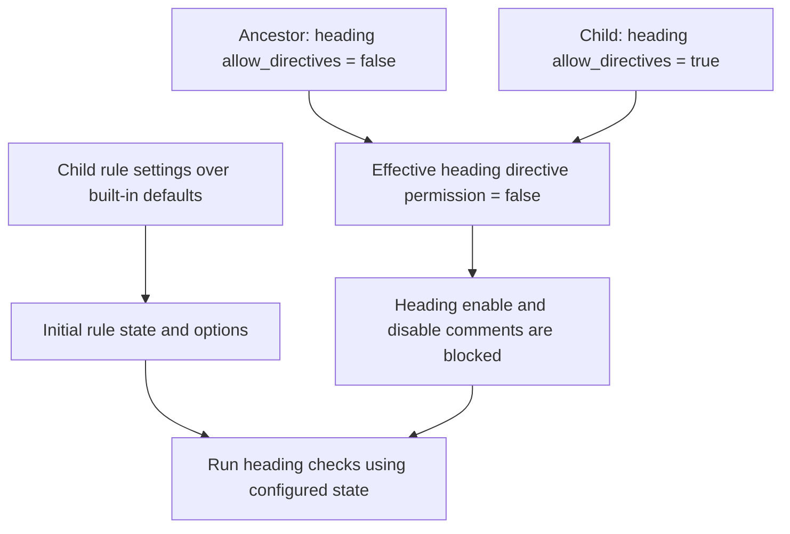
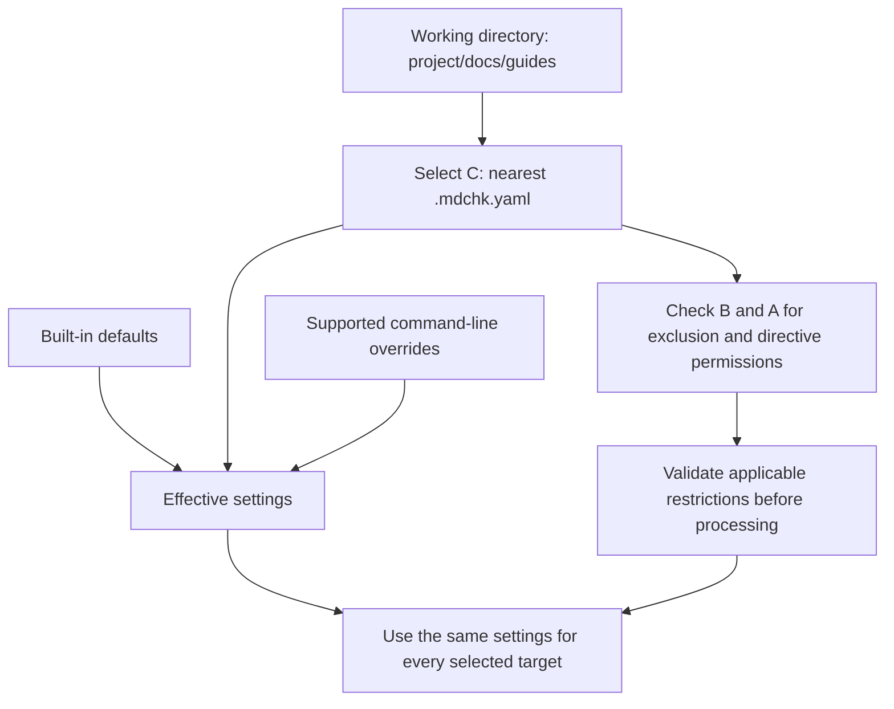
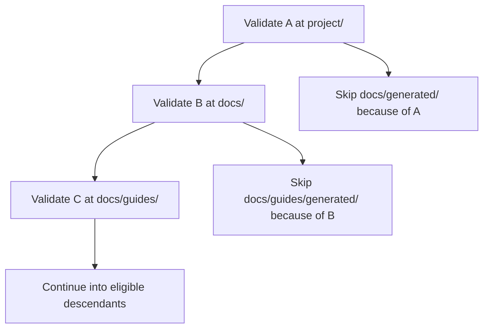

# Configuring mdchk

Use `.mdchk.yaml` to define your project's Markdown expectations. Lint and fix use the same rules and exclusions, whether you run them from the terminal or through the project's MCP server. Without a configuration file, mdchk uses its defaults.

## Define project expectations

Place `.mdchk.yaml` in your project root:

```yaml
version: 1
flavor: gfm
exclude:
  - "vendor/**"
  - "docs/generated/**"
rules:
  final-newline:
    enabled: true
  heading-increment:
    enabled: true
  unordered-list-marker:
    enabled: true
    marker: "-"
```

`version` identifies the configuration schema and is required. Use `1`.

`flavor` selects Markdown interpretation: `commonmark`, `gfm`, or `pandoc`. CommonMark is the foundation; the default is `gfm`, which adds GitHub Flavored Markdown extensions. It applies consistently to lint, fix, inspect, and MCP operations. See [Markdown formats](markdown-formats.md) for the support contract and conformance status.

Frontmatter recognition is independently optional for every supported flavor. Its configuration syntax and default remain undecided; choosing a flavor does not itself enable metadata headers. See [optional frontmatter headers](markdown-formats.md#optional-frontmatter-headers).

`exclude` lists paths to skip. Patterns are relative to the configuration file's directory; for example, `docs/generated/**` excludes files beneath that directory. Exclusions apply even when you name a file explicitly. Skipped files appear in the report. If no files are selected, mdchk reports an error rather than a clean check.

See [file selection and exclusions](file-selection.md) for command-specific behavior and the glob, case, hidden-directory, and platform details still awaiting implementation. Configuration exclusions are separate from Git ignores: config validation honors Git ignores, while Git ignore support for lint and fix is deferred.

To exclude a whole file from all rule linting, list its path under `exclude`. Inline directives are for exceptions to specific rules within a document; they are not intended to suppress all rule linting across a file. Explicit inspection remains available for an excluded target.

`rules` sets expectations by rule name. Use `enabled: true` to enable a rule or `enabled: false` to disable it. Rule-specific options, such as the list `marker` above, sit alongside `enabled`. Omitted rules and options keep their defaults.

The examples above use preliminary descriptive rule names. The [implementation ruleset](rules/index.md) adopts 89 numeric rule IDs; each rule page defines its option schema and default enablement. Descriptive aliases remain to be mapped before implementation.

## Control inline directives

Markdown [directives](directives.md) can enable or disable rules from a comment onward. Set `directives.enabled: false` to disable all directive effects, or set a rule's `allow_directives: false` to prevent comments from changing that rule. Both permissions default to `true`.

```yaml
version: 1
directives:
  enabled: true
rules:
  heading-increment:
    enabled: true
    allow_directives: false
```

An allowed enable directive can activate a rule disabled in configuration. Use `allow_directives: false` when the configured state must hold throughout the file. Directive permissions apply equally to lint, fix, inspect, and MCP requests.

### Enforce directive restrictions in descendant configurations

Directive permissions are inherited restrictions. An ancestor's `directives.enabled: false` blocks all directives in descendant configurations. An ancestor's `rules.<rule>.allow_directives: false` blocks directives for that rule. A child may add restrictions, but cannot remove an ancestor's restriction, including when selected explicitly with `--config`.

For each permission, combine the selected configuration and applicable ancestor values with logical AND: every applicable value must permit the effect. Omitted permission fields default to `true`; omission or an explicit `true` does not undo an inherited `false`. An attempted relaxation is valid configuration, but ineffective; inspection identifies the ancestor responsible. This differs from prohibited nested exclusion additions, which are configuration errors.

For example, a project-root configuration can protect heading checks from inline exceptions:

```yaml
version: 1
rules:
  heading-increment:
    enabled: true
    allow_directives: false
```

A descendant can enable language-label checks while attempting to permit heading directives:

```yaml
version: 1
rules:
  fenced-code-language:
    enabled: true
  heading-increment:
    allow_directives: true
```

When the descendant is selected, its rule settings apply over built-in defaults, but heading directives remain prohibited by the ancestor. Heading checks remain enabled here because their built-in default is enabled. Language-label checks are enabled by the child, and their directives remain permitted unless another ancestor restricts them.



These permissions restrict what Markdown comments may change. They do not force a child's `enabled` setting to match the ancestor: a child can still disable a rule in configuration. Mandatory rule enablement and locked rule options are not defined by this policy. To prohibit every inline rule-state change, set `directives.enabled: false` in the project-root configuration.

Ancestor checks use the same discovery boundaries as exclusion permissions. Lint, fix, and inspect check ancestors of the selected configuration up to the repository boundary when identifiable, or the filesystem root otherwise. Project MCP never reads above its configured root. Standalone MCP has only its submitted configuration, so it has no ancestor policy to inherit.

## Restrict lower-level exclusions

A higher-level configuration can prevent configurations below it from adding ignored paths:

```yaml
version: 1
allow_nested_excludes: false
exclude:
  - "docs/generated/**"
```

`allow_nested_excludes` defaults to `true`. Setting it to `false` permits this file's own exclusions but prohibits nonempty `exclude` lists in descendant configuration files. Descendants cannot restore the permission with `allow_nested_excludes: true`. A conflicting definition is a configuration error, and its exclusions are not applied.

This policy governs mdchk configuration exclusions. It does not change Git ignore rules or introduce a separate mdchk ignore-file format. Applicable higher-level restrictions are checked even when a lower-level file is selected with `--config`. Discovery boundaries still apply: terminal commands stop at the repository root when identifiable, and project MCP never searches outside its configured root.

## Choose a configuration file

For terminal commands, mdchk searches from the working directory upward for the nearest `.mdchk.yaml`, stopping at the repository root when identifiable, or the filesystem root otherwise. It uses one configuration file for rule settings; ancestor rule settings are not merged and nested files do not override them. Higher-level exclusion and directive permissions are checked separately and cannot be overridden by the selected file.

Use `--config` to choose a file explicitly:

```sh
mdchk lint docs/ --config .mdchk.yaml
mdchk fix docs/ --config .mdchk.yaml
```

Settings apply in this order: built-in defaults, the selected configuration file, then supported command-line overrides.

For MCP project mode, configuration discovery stays within the server's configured project root. Standalone MCP requests supply a configuration object using the same settings, instead of a file path. See the [MCP guide](commands/mcp.md) for request examples.

For [inspect](commands/inspect.md), discovery starts at the resolved target file's directory. Use its `--config` option to choose a file explicitly.

## Resolve multiple configurations along a project path

Consider a repository containing three configuration files:

```text
project/                         ← repository boundary
├── .mdchk.yaml                  ← A: project configuration
├── README.md
└── docs/
    ├── .mdchk.yaml              ← B: documentation configuration
    ├── generated/
    │   └── reference.md
    └── guides/
        ├── .mdchk.yaml          ← C: guide configuration
        └── setup.md
```

For lint and fix, first choose one configuration by searching **upward from the working directory**. That choice applies to every target in the invocation. The path to a target does not cause mdchk to load configurations as it descends toward the file.

| Working directory | Command | Selected configuration |
| --- | --- | --- |
| `project/` | `mdchk lint docs/guides/setup.md` | A |
| `project/` | `mdchk lint .` | A for all selected Markdown, including files beneath B and C |
| `project/docs/` | `mdchk lint guides/setup.md` | B |
| `project/docs/guides/` | `mdchk lint setup.md` | C |
| `project/` | `mdchk lint docs/guides/setup.md --config docs/.mdchk.yaml` | B, explicitly selected |
| `project/` | `mdchk inspect docs/guides/setup.md` | C, because inspect starts at the resolved target's directory |

If C is absent, discovery from `guides/` finds B. If B is also absent, it finds A. If none is found before the discovery boundary, built-in defaults apply. An invalid nearest configuration is an error; discovery does not skip it and fall back to a valid ancestor.

### Settings come from one selected file

The following diagram shows a lint or fix invocation from `project/docs/guides/`:



Suppose A enables `unordered-list-marker` with `marker: "-"`, while C contains only `version: 1`. Selecting C leaves that rule at its built-in default: disabled. It does not inherit A's rule setting. The same principle applies to flavor, directive settings, and other omitted options.

For lint and fix, the selected file also supplies the `exclude` list. A and B's exclusion lists are not accumulated into C's selection settings. Each pattern in C is relative to `project/docs/guides/`. Ancestor exclusion and directive **permissions** are checked separately. The selected file's directive permissions are subject to inherited restrictions.

### Ancestor permissions still apply

If A sets `allow_nested_excludes: false`, B and C cannot define nonempty exclusion lists. Selecting C with `--config` does not bypass A's restriction. A descendant also cannot restore permission by explicitly setting `allow_nested_excludes: true`.

```text
A: allow_nested_excludes: false
│  Descendant exclusion additions are prohibited.
│
├── B: version: 1
│      Valid; omission does not restore permission.
│
└── C: exclude: ["generated/**"]
       Configuration error when C is selected or validated.
       Its exclusions are not applied.
```

An applicable ancestor definition that cannot be validated also prevents normal configuration resolution. Lint and fix stop with a configuration error before processing files; inspect marks configuration-dependent data unresolved. These checks stay within the operation's discovery boundary.

### Validation walks downward and accumulates exclusions

`mdchk config validate .` from `project/` performs a different task: it walks downward to validate every eligible definition. It checks A before applying A's exclusions to descendants, then does the same for B and C if their directories remain eligible. It carries valid ancestor exclusions and exclusion permissions down the scan path. Rule settings are still validated independently rather than merged.

Directive restrictions are also carried down the validation scan. A child's `true` under an inherited directive prohibition is valid but cannot relax it. Starting the scan below an ancestor does not discover that ancestor's policy.

For example, if A excludes `docs/generated/**` and B excludes `guides/generated/**`, both exclusions affect the validation scan, each relative to its defining directory:



This example assumes ancestor permissions allow B's exclusions. Git ignores also filter this scan. A skipped directory is not entered, so configurations inside it are not validated. An invalid definition is reported and contributes no exclusions; the scan continues using valid inherited restrictions. A configuration cannot exclude its own validation.

Starting validation at `project/docs/` instead makes that directory the scan boundary: it validates B and eligible descendants without reading A. To check restrictions across the entire repository, run validation from `project/`. See [config validate](commands/config/validate.md) for full traversal behavior.

Project MCP keeps discovery and ancestor checks inside its configured root. Standalone MCP receives one configuration object per request and has no configuration hierarchy to traverse.

## Resolve configuration errors

Run [config validate](commands/config/validate.md) to check every eligible configuration definition in your project:

```sh
mdchk config validate .
```

The scan includes nested configurations and respects Git ignores and configuration exclusions. It reports all discovered definition errors without changing files.

mdchk rejects unknown settings, unknown rule names, invalid rule options, and unsupported schema versions. For lint and fix, configuration errors stop the operation before fixes are written. Config validate continues scanning other eligible definitions. An unreadable configuration file is also a configuration error.

Terminal commands return exit code `12` for these errors; MCP calls report a `configuration` error. Read the accompanying message, correct the file or submitted settings, and retry. See the [exit code guide](exit-codes.md) for other outcomes.

Configuration controls expectations and selection. It cannot turn lint into fix or grant the MCP server access outside its configured root.
